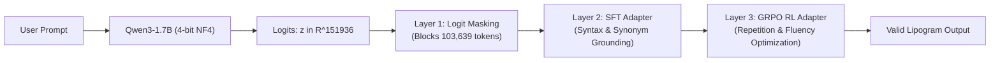

# Qwen, Minus the E: Constrained Language Modeling and Lipogram Post-Training

[](https://pytorch.org/)
[](https://huggingface.co/prateekfr/qwen3-1.7b-no-e)
[](https://huggingface.co/prateekfr/qwen3-1.7b-no-e-lora)
[](https://github.com/huggingface/peft)
[-green.svg)](https://nvidia.com)
[](LICENSE)
[-red.svg)](https://en.wikipedia.org/wiki/Lipogram)

This repository provides an end-to-end post-training pipeline for fine-tuning **Qwen3-1.7B** to adhere to a strict character-level constraint: generating coherent, grammatically sound English without ever using the letter "e" or "E" (a lipogram). The pipeline is engineered to execute entirely on consumer hardware within a **4.0 GB VRAM limit** (NVIDIA GeForce RTX 3050 Laptop GPU).

---

## Table of Contents
1. [Methodology](#methodology)
2. [Systems and Memory Engineering](#systems-and-memory-engineering)
3. [Dual-Engine Reward Framework](#dual-engine-reward-framework)
4. [Benchmark Evaluation](#benchmark-evaluation)
5. [Inference and Interactive CLI](#inference-and-interactive-cli)
6. [Hugging Face Model Hub and Ollama Deployment](#hugging-face-model-hub-and-ollama-deployment)
7. [Repository Structure](#repository-structure)
8. [Citation and Attribution](#citation-and-attribution)

---

## Methodology

Language models process text as discrete sub-word tokens rather than individual characters. Because token embeddings do not encode constituent characters directly, standard autoregressive models cannot natively respect character-level constraints. To enforce strict lipogram generation without model collapse, this project utilizes a three-layer post-training architecture:



### Layer 1: Logit Masking (Inference Constraint)
- Pre-computes a static boolean mask across the 151,936-token vocabulary.
- Flags all tokens containing "e", "E", or Unicode accented equivalents via NFKD normalization.
- Mask blocks **103,639 tokens (68.33% of the total vocabulary)** by setting logits to $-\infty$ during sampling.

### Layer 2: Supervised Fine-Tuning (SFT)
- Trains on 180 curated, human-verified e-free instruction-response pairs extracted from *No Robots* and *Databricks Dolly-15k*.
- Re-grounds syntax and shifts probability mass toward valid e-free alternatives, replacing common functional vocabulary (*the*, *be*, *are*, *were*, *have*).

### Layer 3: Group Relative Policy Optimization (GRPO)
- Samples a group of $G = 4$ candidate completions per prompt.
- Computes relative advantages by normalizing reward signals within each group:
  $$\hat{A}_i = \frac{R_i - \text{mean}(R)}{\text{std}(R)}$$
- Eliminates the need for a separate Critic/Value network, enabling policy optimization directly under tight hardware constraints.

---

## Systems and Memory Engineering

Standard 16-bit RL pipelines require 16 to 24 GB of VRAM to host the active actor, frozen reference baseline, critic, and reward models. To train on a single 4.0 GB VRAM GPU, the following systems-level optimizations were implemented:

| Memory Component | Standard BF16 Training | Our 4-bit Dual-Adapter Architecture |
| :--- | :---: | :---: |
| Base Model Parameters | 3.40 GB | **1.14 GB** (NormalFloat4) |
| Active Policy Adapter | 3.40 GB | **0.066 GB** (LoRA $r=16, \alpha=16$) |
| Reference Baseline Adapter | 3.40 GB | **0.066 GB** (Shared 4-bit Base Model) |
| Optimizer States (AdamW) | 6.80 GB | **0.13 GB** (Adapter parameters only) |
| Activation Buffers | 4.00+ GB | **~0.60 GB** (Activation Recomputation) |
| **Peak VRAM Consumption** | **> 17.6 GB (OOM)** | **~3.44 GB (Stable Headroom)** |

- **Dual-Adapter PEFT Architecture:** Rather than loading a separate frozen base model to calculate KL divergence drift, both the trainable policy and frozen reference baseline are instantiated as lightweight LoRA adapters attached to the *same* 4-bit base weights. Switching between adapters during rollouts adds only 66 MB of overhead.
- **Activation Recomputation:** Non-reentrant gradient checkpointing is configured on the quantized model layers (`use_reentrant=False`), eliminating activation memory bottlenecks without numerical instability.

---

## Dual-Engine Reward Framework

Configured via a single parameter in `configs/default.yaml` and `.env`:

```yaml
reward:
  mode: "local"   # "local" for offline heuristics, or "api" for remote LLM judge
```

1. **Local Composite Heuristic (Offline, Deterministic):**
   - **Hard Lipogram Gate:** Any occurrence of "e" or "E" immediately assigns $R = 0.0$.
   - **Trapezoidal Length Shaping:** Rewards concise answers (25 to 80 tokens) and penalizes truncation or verbosity.
   - **N-Gram Entropy Penalty:** Penalizes repetitive loops using unique 2-gram and 3-gram ratios.
   - **Lexicon Verification:** Validates tokens against an 80,549-word English dictionary (`data/dictionary/english_words.txt`).
   - **Topical Alignment:** Scores keyword overlap between prompt and response.

2. **Remote API-as-a-Judge (OpenAI / OpenRouter Compatible):**
   - Compatible with OpenAI, OpenRouter, Groq, or local vLLM/Ollama endpoints.
   - Evaluates Coherence (1-5) and Response Relevance (1-5).
   - Automatically falls back to the Local Composite Heuristic if network timeouts or rate limits occur.

---

## Benchmark Evaluation

Evaluated across standardized benchmark prompts from `data/prompts/short_eval_50.jsonl`:

| Model Architecture | Strict Lipogram Pass | Usable Rate | Mean Reward | Repetition Diversity | Lexicon Validity | Status |
| :--- | :---: | :---: | :---: | :---: | :---: | :---: |
| **Base Qwen-1.7B + Mask** | 88.0% | **28.0%**\* | 0.6731 | 91.5% | 100.0% | Baseline with foreign evasion |
| **SFT (180 Rewrites) + Mask** | 96.0% | **80.0%** | 0.8436 | 91.5% | 100.0% | Syntax restored (0% evasion) |
| **RL (GRPO Best) + Mask** | **100.0%** | **88.0%** | **0.8895** | **92.5%** | 100.0% | Optimal coherence and diversity |

### Note on Base Model Usable Rate (28.0% vs. 56.0% Raw)
An offline heuristic initially scored the Base Model at 56.0% usable because it only verified the absence of the Latin character "e". Qualitative inspection revealed that an unaligned base model circumvents the English constraint by substituting non-ASCII tokens (Chinese, Russian Cyrillic, Japanese) to satisfy prompt concepts. 

Filtering for pure ASCII English (`response.isascii()`) disqualifies 7 out of 14 raw passes, resulting in a true usable rate of **28.0% (7/25)**, aligning with literature baselines (~26%). Both the SFT and RL models exhibited **0% foreign token evasions**, maintaining 80.0% and 88.0% usability under strict ASCII evaluation.

### Post-Training Progression Analysis
| Stage | Baseline Literature Target | Measured Usable Rate | Progression Status |
| :--- | :---: | :---: | :---: |
| **Base Model + Mask** | 26.0% | **28.0%**\* (56.0% raw) | Verified Baseline |
| **SFT (180 Rewrites) + Mask** | 35.0% | **80.0%** | Substantial Uplift |
| **RL (GRPO) + Mask** | 60.5% | **88.0%** | High Alignment |

---

## Inference and Interactive CLI

### Environment Setup
```bash
conda create -n qwen-no-e python=3.11 -y
conda activate qwen-no-e
pip install torch torchvision --index-url https://download.pytorch.org/whl/cu124
pip install transformers peft bitsandbytes accelerate datasets pyyaml
python scripts/verify_env.py
```

### Interactive CLI Chat
Run real-time inference with decoding-time masking and dynamic model switching:
```bash
python scripts/chat_no_e.py
```

Available commands within the terminal session:
- `:mode rl` - Activate the GRPO RL model (default)
- `:mode sft` - Activate the SFT model
- `:mode base` - Activate the Base model with token mask
- `:temp <float>` - Adjust sampling temperature (default: 0.7)
- `:tokens <int>` - Set max generation tokens (default: 60)
- `exit` or `quit` - Terminate session

### Automated Benchmark Suite
```bash
python evaluation/benchmark_suite.py --limit 25
```

---

## Hugging Face Model Hub and Ollama Deployment

The post-trained models and GGUF binaries are publicly hosted on the Hugging Face Hub:
- **Standalone FP16 Model & GGUF Binary:** [prateekfr/qwen3-1.7b-no-e](https://huggingface.co/prateekfr/qwen3-1.7b-no-e)
- **PEFT LoRA Adapter:** [prateekfr/qwen3-1.7b-no-e-lora](https://huggingface.co/prateekfr/qwen3-1.7b-no-e-lora)

### 1. Direct Inference via Hugging Face Transformers
To generate strict lipograms with the standalone merged model without PEFT dependencies:
```python
import torch
from transformers import AutoModelForCausalLM, AutoTokenizer

model_id = "prateekfr/qwen3-1.7b-no-e"
tokenizer = AutoTokenizer.from_pretrained(model_id)
model = AutoModelForCausalLM.from_pretrained(
    model_id,
    torch_dtype=torch.float16,
    device_map="auto"
)
model.eval()

# Construct decoding-time mask blocking all tokens containing 'e' or 'E'
vocab_size = model.config.vocab_size
forbidden_mask = torch.zeros(vocab_size, dtype=torch.bool)
for token_id in range(vocab_size):
    token_str = tokenizer.decode([token_id])
    if "e" in token_str.lower():
        forbidden_mask[token_id] = True

# Generate response
prompt = "Explain why the sky is blue."
inputs = tokenizer(f"<|im_start|>user\n{prompt}<|im_end|>\n<|im_start|>assistant\n", return_tensors="pt").to("cuda")

with torch.no_grad():
    curr_ids = inputs["input_ids"]
    for _ in range(60):
        outputs = model(input_ids=curr_ids)
        scores = outputs.logits[:, -1, :].clone().float()
        scores[:, forbidden_mask.to("cuda")] = -float("inf")
        next_token = torch.multinomial((scores / 0.7).softmax(-1), num_samples=1)
        if next_token.item() == tokenizer.eos_token_id:
            break
        curr_ids = torch.cat([curr_ids, next_token], dim=-1)

print(tokenizer.decode(curr_ids[0][inputs["input_ids"].shape[1]:], skip_special_tokens=True).strip())
```

### 2. Local Deployment via Ollama (Pre-Converted GGUF)
To run the model locally in Ollama using the pre-converted FP16 GGUF binary:
```bash
# 1. Download the GGUF binary from Hugging Face into weights/
huggingface-cli download prateekfr/qwen3-1.7b-no-e qwen3-1.7b-no-e-f16.gguf --local-dir weights

# 2. Register and start the Ollama model using the project Modelfile
ollama create qwen3-no-e -f Modelfile
ollama run qwen3-no-e
```

### 3. Local Model Export & Conversion Pipeline
To replicate the merging, GGUF conversion, or Hub publishing pipelines from local checkpoints:
```bash
# Merge LoRA adapter into base weights (produces standalone FP16 model)
python scripts/merge_adapter.py --base weights/qwen3-1.7b --adapter checkpoints/rl_best --output weights/qwen3-1.7b-no-e-merged

# Convert standalone model to GGUF format
python scripts/convert_hf_to_gguf.py weights/qwen3-1.7b-no-e-merged --outfile weights/qwen3-1.7b-no-e-f16.gguf --outtype f16

# Publish to Hugging Face Hub (reads HF_TOKEN from .env or CLI)
python scripts/publish_to_hf.py --repo-id prateekfr/qwen3-1.7b-no-e --model-path weights/qwen3-1.7b-no-e-merged --gguf-file weights/qwen3-1.7b-no-e-f16.gguf
```

---

## Repository Structure

```
qwen-3-1.7b-finetuning/
├── checkpoints/
│   ├── sft_best/                  # Optimal SFT adapter weights (Epoch 3, Val Loss: 2.5692)
│   ├── rl_best/                   # Optimal RL adapter weights (Step 26, Mean Reward: 0.9952)
│   └── rl_step_{10,20,30}/        # Periodic training checkpoints
├── configs/
│   └── default.yaml               # Training, LoRA, and reward engine configuration
├── core/
│   ├── checks.py                  # NFKD lipogram validation routines
│   ├── llm_api.py                 # API judge client with exponential backoff
│   ├── rewards.py                 # Dual-engine reward coordinator
│   └── sampling.py                # Logit mask constructor (103,639 tokens blocked)
├── data/
│   ├── dictionary/                # Curated 80,549-word English dictionary
│   ├── prompts/                   # Benchmark prompt sets (short_eval_50.jsonl)
│   └── rewrites/splits/           # 180 validated e-free instruction pairs
├── docs/
│   ├── ARCHITECTURE.md            # Systems and module design documentation
│   ├── EXPERIMENT_LOG.md          # Experiment tracking and metric logs
│   ├── LEARNING_GUIDE.md          # Technical analysis of post-training dynamics
│   ├── MEMORY.md                  # Project context document
│   └── PLAN.md                    # Milestone roadmap
├── evaluation/
│   ├── benchmark_suite.py         # Multi-model evaluation harness
│   └── reports/                   # Output metrics and comparison reports
├── scripts/
│   ├── chat_no_e.py               # Interactive CLI chat interface
│   ├── convert_hf_to_gguf.py      # GGUF converter supporting Qwen3
│   ├── merge_adapter.py           # LoRA weight merging utility
│   ├── publish_to_hf.py           # Hugging Face Hub uploader with Model Card generator
│   ├── test_trained_rl.py         # Comparative generation inspection script
│   ├── test_trained_sft.py        # SFT verification script
│   └── verify_env.py              # Environment diagnostic tool
├── training/
│   ├── train_sft_4bit.py          # 4-bit QLoRA SFT training implementation
│   └── train_grpo_4bit.py         # 4-bit Dual-Adapter GRPO implementation
├── weights/
│   └── qwen3-1.7b/                # Base model weights and tokenizer
├── Modelfile                      # Ollama model definition
├── .env.example                   # Environment configuration template
└── README.md                      # Project documentation
```

---

## Citation and Attribution

- **Lead Engineer & Author:** Prateek
- **Base Model:** [Qwen3-1.7B](https://huggingface.co/Qwen/Qwen3-1.7B) by Alibaba Cloud / Qwen Team
- **License:** Apache 2.0
