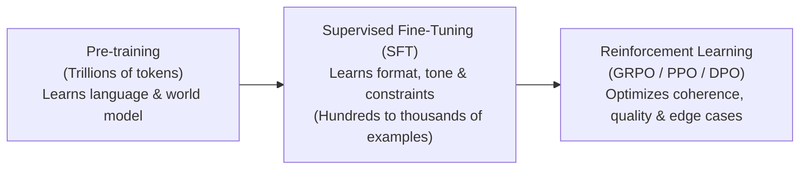
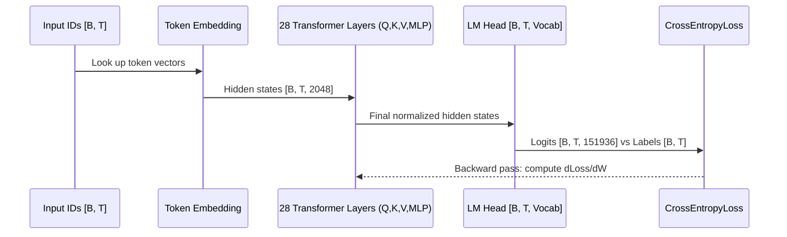

# 📘 The AI Engineering Field Guide: LLM Fine-Tuning & Alignment From First Principles

> **Context:** Created for an engineer bridging Forward Deployed Engineering (FDE) back into
> core AI Engineering. Using the live *"Qwen, Minus the E"* project on consumer hardware (4 GB RTX 3050),
> this guide breaks down every single mathematical concept, training mechanic, and systems-level optimization
> from first principles.

---

## Table of Contents
1. [The Paradigm Shift: Classical ML vs. LLM Post-Training](#1-the-paradigm-shift)
2. [The Core Anomaly: Tokenization & The Lipogram Problem](#2-tokenization--the-lipogram-problem)
3. [The Forward & Backward Pass (Under the Hood)](#3-the-forward--backward-pass)
4. [Loss Functions & The Anatomy of Next-Token Prediction](#4-loss-functions--label-shifting)
5. [The Geometry of Optimization: Gradients, Accumulation & AdamW](#5-gradients-accumulation--adamw)
6. [Systems & Memory Engineering: How We Fit in 4 GB VRAM](#6-systems--memory-engineering)
   - [Memory Breakdown Formula](#memory-breakdown)
   - [4-bit NormalFloat (NF4) & QLoRA](#quantization--qlora)
   - [Low-Rank Adaptation (LoRA) Deep-Dive](#lora-deep-dive)
   - [Gradient Checkpointing (Activation Recomputation)](#gradient-checkpointing)
7. [Inference Mechanics: Logits, Sampling & Token Masking](#7-inference-mechanics)
8. [Reinforcement Learning & Alignment: GRPO vs. PPO](#8-reinforcement-learning--grpo)
10. [Loss Dynamics & Perplexity Math](#10-loss-dynamics--perplexity)
11. [The Information-Theoretic Entropy Floor of Constrained Tasks](#11-entropy-floor)
12. [Overfitting, Generalization & Early Stopping on Small Datasets](#12-overfitting--generalization)
13. [Hardware & Thermal Systems Engineering](#13-thermal-systems-engineering)
14. [Key Terms Quick Reference Glossary](#14-glossary)

---

## 1. The Paradigm Shift

In classical machine learning, we trained models from scratch on tabular or perceptual features to minimize a task loss.
In modern LLM engineering, we almost never train from scratch. The lifecycle is:



- **Pre-training:** Teaches the model grammar, reasoning, facts, and token distributions.
- **SFT:** Steers the model to produce specific target formats (e.g. chat dialogues, JSON schemas, or writing without the letter "e").
- **RL (GRPO):** Aligns the model with subjective objectives (e.g., scoring high under an LLM judge, avoiding loopholes).

---

## 2. Tokenization & The Lipogram Problem

### Why LLMs Can't "See" Letters
Computers process strings, but Transformers process **tokens** (integers).
A tokenizer uses **Byte-Pair Encoding (BPE)**:
- Common words are single tokens: `" the"` $\rightarrow$ `ID: 279`.
- Subwords: `"finetun"` $\rightarrow$ `ID: 84920`, `"ing"` $\rightarrow$ `ID: 320`.

```
Raw text: "The dog runs"
Token IDs: [1352, 5642, 6821]
Embedding vectors: [E(1352), E(5642), E(6821)] (each of shape [1, 2048])
```

Because the Transformer only receives the vector `E(1352)`, it does **not** see the characters `['T', 'h', 'e']`. It has no character awareness unless explicitly taught through massive multi-task character tasks.

### The Two-Layer Solution
1. **Hard Decoding Mask (Inference-time guarantee):**
   Before sampling, identify all token IDs in the vocabulary whose decoded string contains `e`, `E`, or accented forms (`é`). Set their logits to $-\infty$. This guarantees zero `e`s, but by itself produces broken gibberish.
2. **SFT + RL (Coherence learning):**
   Teach the model's probability distribution to place mass only on valid words that don't need `e` (e.g., using *"a hound runs swift"* instead of *"the dog is running"*).

---

## 3. The Forward & Backward Pass



### The Forward Pass
Given input token sequence $X = [x_1, x_2, \dots, x_T]$:
1. **Embedding:** $H_0 = \text{Embed}(X) \in \mathbb{R}^{B \times T \times d}$
2. **Attention & FFN (28 layers in Qwen3-1.7B):**
   $$H_{l} = H_{l-1} + \text{Attention}(\text{RMSNorm}(H_{l-1}))$$
   $$H_{l} = H_{l} + \text{MLP}(\text{RMSNorm}(H_{l}))$$
3. **LM Head Projection:**
   $$\text{Logits} = H_{28} \cdot W_{\text{lm\_head}}^T \in \mathbb{R}^{B \times T \times V}$$
   Where $V = 151,936$ (vocabulary size). Each number represents the unnormalized log-probability of every possible next token!

---

## 4. Loss Functions & Label Shifting

### Next-Token Prediction
Language models are autoregressive. At position $t$, the model must predict token $x_{t+1}$.

```
Input Tokens:   [ "What",  "is",    "a",   "dog" ]
Target Labels:  [ "is",    "a",     "dog", "<eos>" ]
```

### Why We Shift Logits and Labels in Code
```python
# shift_logits: drop the last position (it has no ground-truth target following it)
shift_logits = logits[..., :-1, :].contiguous()  # shape: [B, T-1, Vocab]

# shift_labels: drop the first position (we don't predict the first token from nothing)
shift_labels = labels[..., 1:].contiguous()  # shape: [B, T-1]
```

### Cross-Entropy Loss Formula
For target token $y_t \in \{1, \dots, V\}$:
$$\mathcal{L} = -\frac{1}{N} \sum_{t=1}^{N} \log P(y_t | x_{\le t}) = -\frac{1}{N} \sum_{t=1}^{N} \left( \text{logits}[t, y_t] - \log \sum_{j=1}^{V} e^{\text{logits}[t, j]} \right)$$

### Why `ignore_index = -100`?
In chat fine-tuning, we do **not** want to train the model to predict the user prompt (it already knows how to read English). We only want to train it on the assistant's response!
- We set `labels = -100` for all prompt tokens.
- PyTorch's `nn.CrossEntropyLoss(ignore_index=-100)` automatically zeroes out the loss contribution for any token with label `-100`.
- Thus, the model only gets penalized for mistakes in its answer!

---

## 5. Gradients, Accumulation & AdamW

### What is a Gradient?
For every trainable parameter $W_{i,j}$ (e.g. in LoRA):
$$\text{Gradient} = \frac{\partial \mathcal{L}}{\partial W_{i,j}}$$
It is the vector indicating: *"If I increase this weight by a tiny amount $\epsilon$, how much will the loss increase or decrease?"*

### Backpropagation
Using the multivariable calculus chain rule:
$$\frac{\partial \mathcal{L}}{\partial W_l} = \frac{\partial \mathcal{L}}{\partial H_l} \cdot \frac{\partial H_l}{\partial W_l}$$
Gradients flow backwards from the loss, through the LM head, through layer 28 down to layer 1.

### Gradient Accumulation (Simulating Big Batches on 4 GB VRAM)
Why couldn't we use batch size 4 on your laptop? Because holding 4 long sequences of activations simultaneously requires ~6-8 GB VRAM.
Instead, we use **Batch Size = 1** and accumulate gradients over 4 steps:

```python
# Step 1, 2, 3, 4:
loss = loss / grad_accum_steps  # scale loss so sum equals true average
loss.backward()  # accumulates gradients into W.grad (W.grad += new_grad)

if (step + 1) % grad_accum_steps == 0:
  optimizer.step()  # update weights using accumulated gradients
  optimizer.zero_grad()  # reset W.grad to zero
```
**Mathematical outcome:** Mathematically identical to running batch size 4, but uses **one-fourth** the peak activation memory!

### The AdamW Optimizer
Standard SGD simply does $W \leftarrow W - \eta \nabla \mathcal{L}$.
AdamW keeps two running statistics for every single weight:
1. **$m_t$ (First moment - Momentum):** Moving average of gradients (smooths out noise).
2. **$v_t$ (Second moment - RMSProp):** Moving average of squared gradients (adapts learning rate per parameter).
3. **Decoupled Weight Decay:** Penalizes large weights directly without tangling it in the gradient moments ($W \leftarrow W(1 - \lambda \eta)$), preventing overfitting.

---

## 6. Systems & Memory Engineering

### The 4 GB VRAM Budget Equation

$$\text{Total VRAM} = \text{Model Weights} + \text{LoRA Weights} + \text{Optimizer States} + \text{Gradients} + \text{Activations} + \text{KV Cache}$$

| Component | Standard 16-bit (Kevin's Setup) | Our 4-bit QLoRA Setup |
|---|---|---|
| **Base Model (1.7B)** | 1.7B $\times$ 2 bytes = **3.4 GB** | 1.7B $\times$ 0.5 bytes = **~1.0 GB** |
| **LoRA Parameters (17.4M)** | 17.4M $\times$ 4 bytes = **66 MB** | 17.4M $\times$ 4 bytes = **66 MB** |
| **Gradients** | Full model = **3.4 GB** | Only LoRA parameters = **66 MB** |
| **Optimizer States (AdamW)** | Full model = 1.7B $\times$ 8 bytes = **13.6 GB** | Only LoRA = 17.4M $\times$ 8 bytes = **139 MB** |
| **Activations (Batch=1)** | Without Checkpointing: **~2.5 GB** | With Checkpointing: **~0.6 GB** |
| **Total** | **> 20 GB** (needs 16-24 GB GPU) | **~2.2 - 3.8 GB (Fits on 4 GB RTX 3050!)** |

---

### Quantization & QLoRA (NF4)
- **Standard FP16/BF16:** 1 sign bit, 5/8 exponent bits, 10/7 mantissa bits = 16 bits (2 bytes per weight).
- **NF4 (NormalFloat 4):** Standard normal distribution $\mathcal{N}(0, 1)$ quantiles partitioned into 16 bins (4 bits = 0.5 bytes).
- **Double Quantization:** Even the quantization scale constants are quantized, saving an additional 0.37 bits per parameter.
- **De-quantization on the fly:** Weights are stored in 4-bit memory in VRAM. During the forward pass, small blocks (64 weights) are dequantized into BF16 in GPU SRAM cache, multiplied with activations, and instantly discarded.

---

### Low-Rank Adaptation (LoRA) Deep-Dive
Instead of updating the massive weight matrix $W_0 \in \mathbb{R}^{d \times k}$:
$$W = W_0 + \Delta W$$
LoRA decomposes $\Delta W$ into two low-rank matrices:
$$\Delta W = \frac{\alpha}{r} (B \cdot A)$$
Where:
- $A \in \mathbb{R}^{r \times k}$ (initialized with Gaussian noise)
- $B \in \mathbb{R}^{d \times r}$ (initialized to **zero**, so $\Delta W = 0$ at step 0)
- $r = 16$ (rank), $\alpha = 16$ (scaling factor)

```
Matrix W0: [2048 x 2048] = 4,194,304 parameters
Matrix A:  [16 x 2048]   =    32,768 parameters
Matrix B:  [2048 x 16]   =    32,768 parameters
Total LoRA: 65,536 parameters (98.4% parameter reduction!)
```

---

### Gradient Checkpointing (Activation Recomputation)
In standard backpropagation, **every intermediate tensor** calculated in the forward pass must be saved in VRAM so the chain rule can multiply them during the backward pass. For 28 layers, this consumes gigabytes of VRAM.
- **With Gradient Checkpointing:**
  During the forward pass, we **discard** intermediate activations between layers and save only the layer inputs.
  During the backward pass, when we need layer 14's activations, we quickly re-run layer 14's forward pass on the fly!
- **Trade-off:** ~25% slower training speed in exchange for **60% VRAM reduction**. This is the key reason training succeeded on your 4 GB GPU!

---

## 7. Inference Mechanics: Logits, Sampling & Token Masking

At generation time, given logits $z \in \mathbb{R}^{V}$:
1. **Masking:** For every token $i$ containing `"e"` or `"E"`:
   $$z_i \leftarrow -\infty$$
2. **Temperature Scaling ($T$):**
   $$P_i = \frac{e^{z_i / T}}{\sum_j e^{z_j / T}}$$
   - $T \rightarrow 0$: Greedy decoding (deterministic, picks $\text{argmax}$).
   - $T = 0.7$: Balanced creativity and coherence.
   - $T > 1.0$: Highly creative / random.
3. **Multinomial Sampling:** Sample token index from categorical distribution $P$. Because $e^{-\infty} = 0$, masked tokens have absolute 0.000% probability of being selected!

---

## 8. Reinforcement Learning: GRPO vs. PPO

### Why GRPO (Group Relative Policy Optimization)?
In classical PPO (Proximal Policy Optimization), training requires **four separate models** in memory:
1. Actor (the policy model being trained)
2. Critic (a Value network estimating expected reward)
3. Reference Model (frozen base model for KL penalty)
4. Reward Model (scores outputs)

Four models would require at least 16-24 GB VRAM.
**GRPO solves this elegantly:**
- It eliminates the Critic network completely.
- For each prompt $q$, it samples a group of $G$ candidate answers $\{o_1, o_2, \dots, o_G\}$.
- It computes relative advantages by normalizing rewards within the group:
  $$\hat{A}_i = \frac{R_i - \text{mean}(R)}{\text{std}(R)}$$
- If an answer scores better than its peers in the group, its probability is pushed up; if worse, pushed down!

### The "Length Shrinking" Phenomenon
Kevin observed during RL that model answers got shorter over time (from ~92 tokens down to ~40 tokens).
Why?
Under an unforgiving constraint (no letter "e"), every extra token is a risk of generating an awkward sentence. A 15-token answer has a high probability of maintaining 100% coherence, whereas a 100-token answer has a much higher chance of hitting an awkward phrasing. The RL optimizer learned this mathematical shortcut!

---

## 10. Loss Dynamics & Perplexity Math

### Connecting Cross-Entropy to Real-World Probability
When training an LLM, developers often track loss numbers like `3.10` or `2.56` without realizing what they mean in terms of model confidence.
The loss function is:
$$\mathcal{L} = -\log P(\text{target token})$$

Solving for $P(\text{target token})$:
$$P(\text{target token}) = e^{-\mathcal{L}}$$

And the **Perplexity ($\text{PPL}$)** is:
$$\text{PPL} = e^{\mathcal{L}}$$
Perplexity represents the *effective number of equally likely tokens* the model is choosing among at every step.

Let's look at the numbers from our actual training run:

| Stage | Cross-Entropy Loss ($\mathcal{L}$) | Target Token Probability ($e^{-\mathcal{L}}$) | Effective Choices ($\text{PPL} = e^{\mathcal{L}}$) | Intuitive Behavior |
|---|---|---|---|---|
| **Base Untrained (Step 0)** | **4.6452** | $0.0096$ (~0.96%) | **104.1 tokens** | Blind guessing among ~104 options; outputs complete gibberish under mask. |
| **Epoch 1** | **2.8950** | $0.0553$ (~5.5%) | **18.08 tokens** | Model begins steering toward e-free nouns and verbs; uncertainty drops by 83%! |
| **Epoch 2** | **2.6372** | $0.0715$ (~7.2%) | **13.97 tokens** | Sentence structures stabilize; uses synonyms ("hound", "canine") naturally. |
| **Epoch 3** | **2.5692** | $0.0766$ (~7.7%) | **13.06 tokens** | Coherent, fluent lipogram generation with zero forbidden letters. |
| **User's Target** | **~1.5000** | $0.2231$ (~22.3%) | **4.48 tokens** | Extremely high confidence in exact next token on every step. |

---

## 11. The Information-Theoretic Entropy Floor of Constrained Tasks

### Why Doesn't Val Loss Drop to 0.5?
In standard LLM training (e.g. natural English chat, code generation), loss can often drop to 1.2 – 1.8. Why does a lipogram model encounter an "entropy floor" around 2.2 – 2.5?

1. **Vocabulary Density Distribution:**
   - In standard English, the letter "e" appears in **~12.7% of all letters** and in ~68% of vocabulary tokens.
   - Core function words — `"the"`, `"be"`, `"are"`, `"were"`, `"he"`, `"she"`, `"they"`, `"there"`, `"where"`, `"when"`, `"before"`, `"after"`, `"between"` — all contain the letter "e".
2. **Lower Ground-Truth Frequency:**
   - In our 180 rewrite targets, sentences must use less frequent words to avoid "e" (e.g., *"A hound runs with vigor in a grassy park"* instead of *"The dog runs happily in the green field"*).
   - Because the pre-trained model has seen the word "hound" far fewer times than "the dog", its baseline logit for rare synonyms is naturally lower.
3. **The Multimodal Target Phenomenon:**
   - There are a dozen valid ways to rewrite a sentence without "e". For the prompt *"Tell me about cats"*, the assistant could start with *"Cats walk softly..."*, *"Felines prowl in night..."*, or *"A small carnivore purrs..."*.
   - Because all three are equally valid English, cross-entropy penalizes the model if it predicts *"Felines"* while the validation target was written as *"Cats"*, even though both are 100% correct lipograms!
   - **Takeaway:** In open-ended constrained tasks, validation loss measures *exact token alignment with the specific human annotator's phrasing*, NOT whether the generation is valid or grammatical. This is why **Generation Evaluation (sampling + rule checking)** is the ultimate source of truth, not validation loss alone.

---

## 12. Overfitting, Generalization & Early Stopping on Small Datasets

When fine-tuning on a small curated dataset ($N=180$ examples):
1. **The Overfitting Risk:**
   - If we train for 10-20 epochs with a high learning rate, the model will simply memorize the 180 answers word-for-word.
   - **Diagnostic Sign:** `train_loss` drops down to `0.5`, but `val_loss` starts rising from `2.5` to `3.2`.
2. **Early Stopping & Checkpoint Selection:**
   - We must track `best_val_loss` at each epoch.
   - Whenever `val_loss < best_val_loss`, we save the adapter to `checkpoints/sft_best/`.
   - If `val_loss` begins increasing for 2 consecutive epochs, we stop training and keep the checkpoint with the lowest validation loss. This is known as **Early Stopping**.

---

## 13. Hardware & Thermal Systems Engineering

### Why Desktop AI differs from Cloud & Laptop AI
When training in the cloud (AWS/GCP A100 or H100 clusters):
- GPUs operate in chilled server racks with active delta fans pushing thousands of CFM of air.
- Clocks remain locked at peak boost frequencies (1400–1800 MHz) with zero thermal throttling.

When training locally on a laptop (RTX 3050 Laptop GPU):
- The GPU share a unified copper heat pipe with the CPU.
- Under sustained 100% compute load, the GPU junction temperature reaches the thermal threshold (~86–87°C).
- The NVIDIA driver triggers **dynamic clock down-throttling** (lowering voltage and core frequency from ~1700 MHz to ~1100 MHz) to maintain a safe temperature around 68–72°C.
- **Impact on Training:** Epoch 1 (running on a cold laptop) took **6.8 minutes**. Once the chassis heat-soaked, subsequent epochs take **18–35 minutes**.
- **Engineering Lesson:** Systems-level AI engineering requires monitoring thermals, TFLOPS degradation, and power budgets, not just VRAM allocation!

---

## 14. Key Terms Glossary

| Term | Definition |
|---|---|
| **Logits** | Unnormalized real-valued output scores from the neural network before softmax. |
| **Softmax** | Function converting real numbers into a probability distribution summing to 1. |
| **Cross-Entropy Loss** | Measure of difference between predicted probability distribution and true one-hot token label. |
| **Validation Loss** | Loss on held-out data not seen during gradient updates. If train loss drops but val loss rises, the model is **overfitting**. |
| **Epoch** | One complete pass through the entire training dataset (all 180 examples). |
| **Perplexity (PPL)** | $e^{\text{Loss}}$ — intuitively, the number of equally likely tokens the model is choosing between. |
| **Gradient** | Derivative of loss with respect to parameters, indicating direction to adjust weights. |
| **Learning Rate ($\eta$)** | Step size multiplier applied to gradients during parameter updates. |
| **LoRA Rank ($r$)** | Dimensionality of low-rank bottleneck matrices ($B \times A$). |
| **LoRA Alpha ($\alpha$)** | Constant scaling factor adjusting the magnitude of LoRA updates. |
| **NF4** | NormalFloat4, an information-theoretically optimal 4-bit data type for normally distributed neural weights. |
| **Gradient Accumulation** | Splitting a logical batch into micro-batches and accumulating gradients before calling `optimizer.step()`. |
| **Gradient Checkpointing** | Discarding forward activations and recomputing them during backprop to save VRAM. |
| **Lipogram** | Constrained writing where a particular letter (or group of letters) is omitted entirely. |
| **GRPO** | Group Relative Policy Optimization — RL without a critic network, calculating advantages relative to group mean. |
| **KL Divergence** | Measure of how much the fine-tuned policy has drifted away from the base reference model. |
